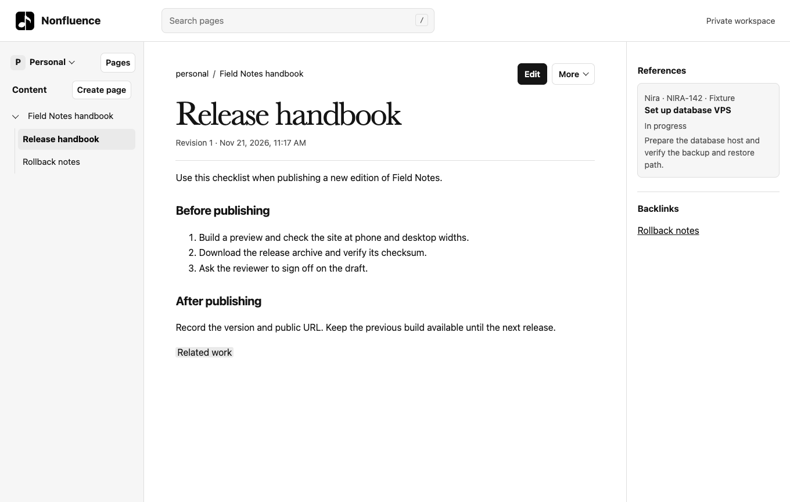

# Nonfluence

Nonfluence is a local Markdown knowledge base with a browser editor and a scoped MCP server. Each page has a permanent UUID, searchable content, a parent, and a revision history. References and the full-text index update in the same transaction as each saved revision.

The screenshot shows a local demo with fictional pages and references. See how Nonfluence fits into the [self-hosted stack](https://obscuretone.com/posts/en/self_hosted_tools).

## Run the demo

From this directory, with Python 3.11 or newer and [uv](https://docs.astral.sh/uv/):

~~~sh
uv sync --locked
uv run --locked python -m nonfluence seed
uv run --locked python -m nonfluence --fixture-nira serve
~~~

Open [Nonfluence on localhost](http://127.0.0.1:8787). The demo contains two nested pages, linked in both directions, plus illustrative ticket and pull request references. Use **Edit** for Markdown and live preview, and the search field to find words in a title or body. Open **More** for **Page history** and **Copy Markdown link**. For a blank workspace, skip the seed or choose another `--space` slug. Each local server instance opens one space.

The default database is `.nonfluence/pages.sqlite3`. Put global flags such as `--db` and `--space` before the subcommand. Use an absolute database path when launching from different working directories.

## Smart hyperlinks

| Markdown destination | Behavior |
| --- | --- |
| `page:<page UUID>` | Opens a stable local page, displays its current title, and creates a backlink. Missing or out-of-space targets appear broken. |
| `nira:<Nira integer ID>` | Reads the ticket title, status, display key, and a short preview on each page load when a Nira source is configured. The integer ID survives project-prefix changes. |
| `nira:<PROJECT-123>` | Matches a display key in the configured Nira source. The offline example uses `nira:NIRA-142`. Use integer IDs for durable links to real tickets. |
| `https://github.com/<owner>/<repo>/pull/<number>` | Creates a typed pull request reference. GitHub issues, commits, and repositories are also recognized. GitHub links open the target and display status as unavailable in this release. |

Nonfluence recognizes typed links from parsed Markdown and skips code spans and fenced code blocks. The MCP `find_backlinks` tool can look up pages linking to a specific page, ticket reference, or GitHub object in the connected space.

### Authorized standalone Nira source

Pass an explicitly authorized Nira v2 SQLite database or a consistent snapshot:

~~~sh
uv run --locked python -m nonfluence \
  --nira-db /absolute/path/to/authorized-nira.sqlite3 \
  --nira-web-url http://127.0.0.1:8765 serve
~~~

`--nira-web-url` is optional and only builds the ticket hyperlink. The adapter opens the database with SQLite `mode=ro` and `query_only`. With a live standalone database, the next request reads the latest committed title and status. For a snapshot while Nira is running, use SQLite’s backup API so committed WAL data is included. The browser and MCP each accept the same source flags.

The SQLite adapter follows standalone Nira’s v2 schema. A hosted workspace can use its read-only Nira HQ connection for project and ticket metadata. The local demo also supports offline fixtures.

## MCP connection

Configure the client to launch the following command using stdio. Replace the paths with the absolute project and database paths.

~~~text
uv --directory /absolute/path/to/nonfluence run --locked python -m nonfluence --db /absolute/path/to/pages.sqlite3 --space personal --fixture-nira mcp
~~~

The server uses the [official MCP Python SDK v1](https://github.com/modelcontextprotocol/python-sdk/tree/v1.x). It exposes `list_pages`, `search_pages`, `read_page`, `page_history`, and `find_backlinks` by default. Add `--write` after `mcp` to enable `create_page` and `update_page` in that space. Initialize the database with `seed` or `serve` before starting a read-only client.

Updates use `expected_revision` from a preceding read. A concurrent edit returns a conflict. For a retried creation, reuse the same optional `request_id` UUID and matching inputs. Tool callers cannot supply a space override. The browser and MCP can use the same database and space, so a saved page is visible from either entry point.

For the hosted personal workspace, `deploy/nonfluence-mcp.service` runs one MCP worker on a private Unix socket. The SSH client's remote command can attach that socket to its existing stdio transport.

~~~sh
sudo -n -u nonfluence /usr/bin/socat STDIO UNIX-CONNECT:/run/nonfluence-mcp/stdio.sock
~~~

The service account owns the socket and its parent directory. Each client has its own MCP session, with the space and permissions set by the worker's service configuration.

## Verify

~~~sh
uv run --locked python -m unittest discover -s tests -v
~~~

The tests exercise actual stdio MCP connections with read and write scopes, concurrent saves and retries, stable links through renames and moves, backlinks, HTML handling, search, the local browser API, and a committed Nira status change in a disposable database.

## Hosted instance

The owner's instance has a [browser sign-in page](https://docs.obscuretone.com/login). Its primary option uses the shared passkey at [login.obscuretone.com](https://login.obscuretone.com/). Only the configured owner subject can enter this workspace. Passkey sessions use secure, host-only cookies and expire after five minutes or at the signed token expiry, whichever comes first. The password remains available under **Use password** as an owner fallback. Nginx limits login attempts and verifies explicit Basic credentials on API requests from existing clients. It connects to Waitress over a restricted Unix socket.

The hosted site keeps pages, revisions, backlinks, search terms, request IDs and browser sessions in the `nonfluence` MariaDB database. The dedicated `nonfluence` system account connects through the local MariaDB Unix socket with privileges on that database. Use the `mariadb` dependency extra and the private configuration file that names the socket, database and account. The passkey drop-in adds `--browser-oidc` to the existing `--browser-login` command and uses the OpenID Connect client settings documented below with the main workspace's existing browser session key.

On the personal hosted site, `--plugins-mariadb-config /path/to/company-database.json` adds a Plugin company entry to the sidebar space switcher. Supply a separate MariaDB database with the private workspace schema, using a local database account available to the hosted process. Both spaces use the site's owner sign-in. Page browsing, editing, and search use the selected space's database.

On the VPS, the following command opens the deployed `personal` space through stdio. Run it in an authorized SSH session or pass it as the SSH remote command in the MCP client's configuration.

~~~sh
cd /srv/nonfluence/current
sudo -n -u nonfluence /srv/nonfluence/venv/bin/python -B -m nonfluence \
  --mariadb-config /var/lib/nonfluence/mariadb.json --space personal mcp
~~~

Append `--write` to enable article writes. The VPS uses the host's existing SSH trust and keeps the MCP transport private.

Previously saved MCP launchers that name the exact old hosted SQLite path require the hosted MariaDB configuration. Use a separate path for isolated SQLite recovery or local demos.

Back up the `nonfluence` schema with the other MariaDB application databases. Restore into an isolated database and compare page and revision counts, stable IDs, search and backlink results before cutover. The schema is in `nonfluence/mariadb_schema.sql`. To import an older SQLite workspace, apply the schema to an empty destination, create its private classification metadata, then run `python -m nonfluence.migrate_mariadb --sqlite <snapshot> --mariadb-config <config>`. The importer verifies pages, history, links, and the rebuilt search index before committing. Clear the restored `owner_sessions` table before exposing a native MariaDB restore so sessions from the snapshot cannot resume.

## Confidential workspace with custom SSO

The confidential mode uses Evan's separate Sanic identity provider as an OpenID Connect client. It requires a dedicated HTTPS origin, SQLite database, and service account. The ordinary web and MCP entry points reject the confidential database. Search, history, links, and titles stay inside the confidential workspace. The owner can use its browser editor after signing in. Confidential content is stored in readable form on the authorized server. Sealed storage with device-held encryption is a separate feature.

Register a confidential client for the dedicated workspace origin. For an origin of `https://vault.obscuretone.com`, the exact callback is `https://vault.obscuretone.com/auth/callback`. Grant the client to the owner and configure their stable subject from the issuer. The provider must support authorization code flow, PKCE S256, nonce, and a fresh passkey authentication for `max_age=0`. Its signed ID token must include `auth_time`. Nonfluence matches issuer and subject, checks authentication freshness, and expires browser sessions after 15 minutes. Signing out revokes the session server-side.

Install the `hosting` and `confidential` dependency extras. Set these environment variables for the dedicated process:

- `NONFLUENCE_OIDC_ISSUER` is the exact HTTPS issuer in the custom provider's discovery document.
- `NONFLUENCE_OIDC_CLIENT_ID` identifies the dedicated client.
- `NONFLUENCE_OIDC_OWNER_SUBJECT` is the owner's subject for that client.
- Supply the client secret and a randomly generated session key with systemd `LoadCredential=` under `oidc-client-secret` and `oidc-session-key`. For a local test process, the corresponding environment variables are `NONFLUENCE_OIDC_CLIENT_SECRET` and `NONFLUENCE_OIDC_SESSION_KEY`.

~~~sh
python -m nonfluence.hosting --confidential --host vault.obscuretone.com \
  --space confidential --db /var/lib/nonfluence-confidential/pages.sqlite3 \
  --socket /run/nonfluence-confidential/web.sock
~~~

Use a private state directory with access limited to the confidential service account, a restricted Unix socket for Nginx, host-specific TLS, and a separate secret set. Disable request access logging for that virtual host so callback codes and confidential page URLs stay out of ordinary logs. Keep the normal service account and MCP launcher outside the confidential state's permissions. Validate sign-in with synthetic pages first, including a denied guest account, and confirm the access boundary before adding real records.

~~~sh
uv run --locked --extra hosting --extra confidential python -m unittest discover -s tests -v
~~~

Multi-user roles, sealed storage, scheduled off-provider backups, attachments, templates, and rendered diagrams remain future work.
